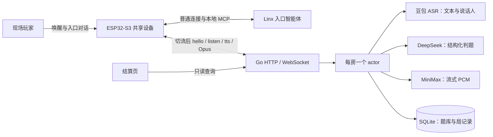

# 海龟汤：Linx + Go 精简方案

> 一台 `yunliao-s3` 放在桌上，多人围坐共玩；玩家现场直接交流，按 BOOT 向 AI 主持人提问。固定房间 1/2/3，每局 10 分钟。当前只做线下共设备模式，不做多设备、独立声纹注册、AI 玩家、真人主持和掉线恢复。

## 1. 方案结论

### 1.1 上游固件与服务端关系

`xiaozhi-esp32` 是开源的 XiaoZhi ESP32 固件项目，负责设备端的音频采集、Opus 编解码、播放、按键、网络连接和 MCP 工具执行。本仓库不重新实现一套设备固件，而是在该开源项目上通过一个小范围 PR 增加海龟汤所需的能力：注册 `self.game.start(room_id)`、切换 Game WSS 地址，以及将游戏收音切换为 manual start/stop 模式。

这里的 Linx 可以理解为 XiaoZhi 固件配置连接的服务端。固件通常通过 OTA 下发或保存 Linx 的 WebSocket 配置，Linx 负责设备激活、OTA、唤醒后的普通入口对话和设备端 MCP 调用。玩家说“进入 2 号房玩海龟汤”时，Linx 智能体识别意图并调用设备本地 MCP；MCP 返回受理结果后，设备关闭当前 Linx 音频连接，使用临时 URL 连接独立的 Go Game WSS。

Linx 与 Go 游戏服务是两个独立的服务端角色：Linx 负责 XiaoZhi 的通用设备服务和入口对话，Go 只负责进入指定房间后的题目、收音、ASR、判题、TTS 和房间状态。Game WSS 不替换固件，也不要求 Linx 承载游戏期间的连续音频；游戏连接结束后，设备回到 idle，下一次唤醒再按 XiaoZhi 的配置重新连接 Linx。

```text
ESP32-S3（yunliao-s3）
  ├─ Linx WSS：OTA、唤醒、入口对话、设备本地 MCP
  └─ Game WSS：manual 收音、AI 主持、Opus 音频
          │
          ▼
       Go 单服务
       ├─ 固定房间 1/2/3
       ├─ 题库、局时、讨论态、固定汤底
       ├─ 豆包 ASR 2.0（中间结果 + 说话人编号）
       ├─ DeepSeek 判题
       └─ MiniMax TTS + Opus/PCM 编解码
```

设备同一时间只连一条语音链路：

```text
玩家：进入 2 号房玩海龟汤
        ↓
Linx 智能体调用设备本地 MCP：self.game.start(room_id=2)
        ↓
设备关闭 Linx 连接，连接 Game WSS：/v1/game?room_id=2
        ↓
Go 将设备加入 2 号房并播放欢迎提示
        ↓
玩家按 BOOT 说“开始游戏”，AI 朗读汤面
        ↓
AI 播报题面后，玩家现场讨论；需要向 AI 提问或猜测汤底时按 BOOT 开始收音，再按一次结束
        ↓
说“退出游戏”或连接断开
        ↓
设备回到 idle；下一次唤醒重新走 Linx
```

不做匹配或排队大厅，也不让云端 MCP 承载连续音轨。Linx 只负责把玩家带进游戏；Go 入房后先播放欢迎提示并等待“开始游戏”，再进入题目状态并维护后续游戏流程。

## 2. 房间与规则

- 固定房间 1、2、3；房间号由 Linx 入口对话选择，并注入智能体提示词。
- 每房一台共享设备，玩家数量按现场空间决定；玩家直接提问，豆包 ASR 区分说话人，服务端自动分配“玩家 1、2、3”用于本局积分。
- 房间状态只在 Go 内存中保存；设备断开即离房，不做断线快照恢复。
- 每局 10 分钟；每次提问最长 60 秒，到时由服务端收麦。
- Game WSS 入房后先播放欢迎提示，不自动开局；玩家说“开始游戏”后才选题并朗读汤面。
- AI 播报题面后，设备处于 idle；玩家之间的普通现场讨论不启动设备收音，也不提交给服务端。
- 玩家需要向 AI 提问、猜测汤底，或在讨论态发出“游戏继续”“退出游戏”等控制指令时，按 BOOT 发送 `listen state=start mode=manual`；说完后再按一次发送 `listen state=stop`。
- 只有一次 manual start 与 stop 之间的音频进入 ASR；stop 后 Go 等待 final 文本，再交给判题或讨论态指令处理。
- 游戏进行中如果忘记汤面，可以按 BOOT 说“再说一遍汤面”或“重复一下汤面”；服务端重播当前固定题面，不触发判题。
- 猜中或超时后朗读固定汤底，进入讨论态，不自动开下一局。
- 讨论态的普通交流不做判题；只有按 BOOT 提交的语音才会被识别，其中“游戏继续”等指令才开新一局。
- 欢迎提示会明确给出“开始游戏 / 游戏继续 / 退出游戏”三个高频指令。
- “退出游戏”由 Game WSS 的 ASR 识别；Go 关闭连接并释放房间。

Go 的房间 actor 串行处理加入、离开、收音、最终文本、AI 判定、TTS 完成和计时器，避免语音回调与局状态互相覆盖。

## 3. 协议：直接复用小智现有消息

Game WSS 不定义第二套状态机，只复用现有小智 WebSocket 格式：

- 连接后设备发 `hello`，服务端返回 `hello`。
- 设备发 `listen state=start mode=manual`，随后上传 Opus 二进制帧。
- 设备发 `listen state=stop` 后，服务端补静音等待豆包 ASR 确定分句。
- 服务端发 `tts state=start`，TTS 分片边到边编码为 Opus 二进制帧，全部尾帧发完后才发 `tts state=stop`。
- `stt`、`tts sentence_start` 只用于显示，不参与控制。

房间从 Game WSS URL 的 `room_id` 查询参数确定；设备身份取握手头 `Device-Id`。房间的“开局、判题、讨论、结束”只存在于服务端，不下发成设备协议。

| 方向 | 消息 | 含义 |
| --- | --- | --- |
| 设备 → Go | `hello` | 声明音频参数 |
| 设备 → Go | `listen start/stop` | BOOT 开始/结束一次向 AI 提问、猜测汤底或控制指令 |
| 设备 → Go | 二进制 Opus | 当前 manual 收音片段；普通现场讨论不上传 |
| Go → 设备 | `tts start` | 进入播报态，设备不收麦 |
| Go → 设备 | 二进制 Opus | AI 主持音频 |
| Go → 设备 | `tts stop` | 本次播放结束；manual 模式下设备回 idle |
| Go → 设备 | `stt` / `tts sentence_start` | 字幕与显示，可省略 |

控制约定只有三条：

1. 播放：`tts start` → 流式 Opus 帧 → 最后音频发完 → `tts stop`。
2. 设备在 AI 播报时处于 `speaking`，BOOT 不启动新一轮收音。
3. `tts stop` 不负责截断播放；固件等待解码队列排空后完成状态切换。

不使用自定义 `waiting/playing/play_done` 消息，也不需要服务端接收“播放完成”。

## 4. 语音流程

### 4.1 开局

1. 设备连接 Game WSS 后，Go 先播放欢迎提示并停在等待开局状态，不自动选题。
2. 玩家按 BOOT 说“开始游戏”，Go 从可配置题库选一题，锁住汤面和汤底。
3. 服务端发 `tts start`，用 AI 音色朗读汤面并提示按键提问、每次一人说话；MiniMax PCM 分片一到就编码为 Opus 匀速下发，尾帧发完再发 `tts stop`。
4. 设备播完后回到 idle；玩家可以现场讨论，只有需要向 AI 提问或猜测汤底时才按 BOOT 开始一次 manual 收音。

### 4.2 玩家提问

1. 玩家需要向 AI 提问或猜测汤底时按 BOOT，设备发 `listen start` 并上传 Opus。
2. Go 将 manual 收音的 Opus 解码为 PCM，持续送入豆包 ASR 2.0。
3. ASR 的 partial 结果只用于日志或显示，不推进游戏状态。
4. 玩家说完后再按 BOOT，设备发 `listen stop`；Go 提交当前 ASR 音频并等待 final。
5. final 文本交给 DeepSeek，判定为 `yes / no / close / irrelevant / correct`，使用 ASR 的说话人编号归属积分（见 4.5）。
6. Go 将判定结果交给 TTS，边收 PCM 分片边编码为 Opus 下发；最后音频完整发出后才进入播放结束，设备回 idle，玩家可以继续现场讨论。

不自己实现 VAD。当前按键 manual 模式由玩家显式按键结束收音；只有按键确认的语音才提交给 Go，ASR 中间结果由厂商提供。

### 4.3 结束与讨论

1. 玩家猜中或局时到，AI 依次播报：“猜对了 / 时间到”、本局冠军、固定汤底、“本轮游戏结束”，并提示“想开新一局请说游戏继续”；完整排名只在结算页展示。
2. 本局进入讨论态，不自动开下一局；玩家可继续现场讨论，普通讨论不会进入 ASR 或判题。
3. 玩家按 BOOT 提交“游戏继续”或“开始游戏”等明确指令后，服务端才开始新一局。
4. 玩家按 BOOT 提交“退出游戏”后，服务端关闭 Game WSS 并释放房间，设备回 idle。

### 4.4 音频格式

- 设备 ↔ Go：Opus，16 kHz、单声道，沿用固件现有编解码。
- Go 内部与 ASR/TTS provider：PCM 16 kHz、单声道、16-bit。
- TTS 流式返回 PCM 分片；Go 缓存不足一帧的尾部并重组为 60 ms Opus 帧，前 5 帧预缓冲后匀速下发。
- 首版不接收或转发玩家之间的音频。

### 4.5 积分与结算页

**玩家身份：** 豆包 ASR 2.0 返回 `utterances[].additions.speaker_id`，服务端按本局首次提问顺序映射“玩家 1、2、3”，不要求报名字。判题模型只输出 `{"verdict":...}`。多说话人或无编号时照常判题，不计个人分。

**积分规则：**

| 判定 | 积分 |
| --- | --- |
| `yes`（问出“是”） | +1 |
| `close`（接近） | +2 |
| `correct`（猜中汤底） | +5 |
| `no` / `irrelevant` | 0 |

排名按积分降序；同分时猜中者优先，再按首次发言顺序。没有人得分时不产生冠军。积分只在本局有效，新一局重新计算；成绩保存在房间 actor 内存中，不落库。

**设备播报：** 局终播报“猜对了。本局冠军是玩家1，得6分。汤底是：……。本轮游戏结束。想开新一局请说“游戏继续”。”，不朗读完整排名；超时则以“时间到。”开头。

**结算页：** Go 服务提供网页，门店用电视或平板打开即可，不需要 App：

- `GET /scoreboard?room_id=1`：结算页，每 2 秒轮询一次，可切换 1/2/3 号房。
- `GET /v1/rooms/{room_id}/scoreboard`：只读数据接口，返回统一 `{code, message, reqid, data}`。

`data` 字段：

| 字段 | 说明 |
| --- | --- |
| `status` | `idle` 未开局 / `playing` 进行中 / `finished` 本局结束 |
| `surface` | 汤面 |
| `answer` | 汤底，仅 `finished` 时返回 |
| `champion` | 冠军名字，仅 `finished` 且有人得分时返回 |
| `players` | 按名次排序：`name`、`score`、`questions`、`yes`、`close`、`correct` |

进行中显示实时积分，局终显示冠军与汤底；下一局开始前保留上一局结果。结算页是门店大屏的只读展示，不要求设备 token。

## 5. AI 主持

AI 只做主持，不拥有答案：

- 朗读汤面。
- 判断玩家问题与固定答案的关系：`yes / no / close / irrelevant / correct`，不承担身份识别。
- 识别玩家是否猜中，组织简短播报。
- 结束时由服务端取固定汤底，交给 TTS 逐字朗读。

固定汤底不能由模型改写。判题输出使用结构化结果，规则命中后由 Go 推进房间，不让模型直接控制房间状态。

## 6. 服务端

一个 Go 进程即可：

- Gin：`/healthz`、Game WSS 升级、`/playground` 联调页。
- GORM + SQLite：题库、汤底、局记录；`config.local.json` 的 `questions` 定义完整启用题库，运行中的房间状态放内存。
- 每房一个 actor：当前设备、局状态、截止时间、讨论态。
- 豆包 ASR 2.0：每台在线设备一个持续会话，manual stop 后补静音获取确定结果。
- 主持智能体：汤面、判题、结束播报。
- TTS + Opus：生成 AI 音频并下发给当前设备。

不做大厅、排队服务、跨进程消息总线、重连快照和复杂协议网关。

## 7. 固件改动

1. `mcp_server.cc` 注册 `self.game.start`，参数 `room_id` 限定为 1、2、3。
2. `application.cc/.h` 增加 `StartGame`；关闭 Linx 后连接 Game WSS。
3. `WebsocketProtocol` 支持临时 URL override，不覆盖 NVS 中的 Linx 配置。
4. 游戏连接切换到 `kListeningModeManualStop`，BOOT 控制一次提问的开始与结束。
5. Game WSS 地址由 `CONFIG_TURTLE_SOUP_GAME_URL` 注入；本地验证可指向局域网地址，真实部署使用可达的 WSS 域名。

设备只保留基础连接状态，房间与游戏阶段全部由服务端维护。ES8388、Opus 编解码、AEC 和分区表不需要为 MVP 改动。

## 8. 首版范围

要做：

- Linx 入口、设备本地 MCP、Game WSS 切换。
- 房间 1/2/3、共享设备、入房欢迎、显式开始、manual 收音、讨论态、确认后开下一局。
- AI 出题、实时语音提问、AI 判定、固定汤底 TTS。
- 60 秒单次提问、10 分钟局时。
- 自然语言继续/退出游戏。

不做：

- 多设备房间、玩家语音转发、独立声纹注册。
- AI 玩家、真人主持。
- 匹配/排队大厅、跨局长期排行榜、多人混音。
- 掉线快照恢复、断线续局。

## 9. 产品与商业价值

**产品定位：给桌游店、剧本杀店增加一个替代一段主持工时的语音加购项目。**

- 一台设备放在桌上，玩家围坐直接交流，不装 App、不拿手机。
- 店里复用闲置包间和换场时间，AI 主持不增加排班。
- 卖点是完整体验：现成设备、题库、自动主持、自动判题、结算页和持续运营。
- 付费假设需用真实门店数据验证：设备采购、房间/月订阅或按局计费。
- TTS 只在固定节点播报，不做持续闲聊，因此单局云成本受控；详细测算见产品文档。

详细定位与商业假设见 [turtle-soup-product-positioning.md](turtle-soup-product-positioning.md)。

## 10. 评分维度与现场证据

| 评分维度 | 评委要看到 | 可执行证据 |
| --- | --- | --- |
| 商业价值 & 产品设计 50% | 谁付费、为什么持续用、单店能否回本 | 一台真机完成开局；玩家现场讨论与提问；30/300 局云成本敏感性；Lite/Standard/Premium 假设；3 家门店 2 周试点指标 |
| 架构设计 20% | 设备薄、服务端权威、协议简单 | Linx 入口与 Game WSS 分工；固定房间；复用 `hello/listen/tts/Opus`；没有自定义 waiting 状态机 |
| AI 价值呈现 15% | AI 真正承担主持人工作 | 自然语言选房/继续/退出；理解不同问法并判定；固定汤底由 AI 音色朗读 |
| AI 工程效率 15% | AI 交付可验证的代码，并把问题沉淀成回归能力 | 四层质量体系：模型基准评测、真实链路 E2E、自动化测试与工程检查、AI 研发 skills；用评估函数判定结果，用 PR 保存修复与验证证据 |

### 10.1 四层质量体系

**AI 的产出不止是代码：每次修改都要能验证，每个已定位问题都要有对应回归，调试经验沉淀为下一次可执行的 skill。**

| 层次 | 要回答的问题 | 项目已有能力 | 证据入口 |
| --- | --- | --- | --- |
| ① 模型基准评测 | AI 主持人判得对不对？ | 固定汤面/汤底、发言和人工预期判定，直接调用真实 LLM；覆盖五类判定及带姓名表述，输出逐例结果、耗时和通过数，失败返回非零退出码 | `server/cmd/eval`，不加 `-e2e` |
| ② 真实链路 E2E | 云端组件连起来、换人发言后还能不能玩？ | 云端语音链：真实 TTS → ASR → LLM → TTS；说话人回归：同一 ASR 连接内 A→B→C→A，校验不同人不合并、同一人不换编号 | `server/cmd/eval -e2e`、`server/cmd/speaker-eval`；完整游戏另用 WebSocket/真机验收 |
| ③ 自动化测试与工程检查 | 改代码会不会破坏已有功能？ | 单元测试覆盖协议、配置、积分、分句和音频边界；本地 WebSocket 集成测试覆盖整局状态；格式、静态分析和 race 检查守住工程底线 | `server/internal/{game,api,config}/*_test.go`；`gofmt`、`go vet`、`go test`、`staticcheck` |
| ④ AI 研发 skills | 调试和交付能否复用，而不是每次重新摸索？ | `AGENTS.md` 约束实现与 PR 流程；skills 指导 AI 做硬件调试、provider 定位、测试选层和提交检查 | 根 `AGENTS.md`；`xiaozhi-yunliao-s3-firmware`、`go-provider-debugging`、`go-test-engineering`、`quick-pr` skills |

分层的作用是定位问题：基准失败先查判题规则；基准通过、语音链失败查 ASR/TTS；云端通过、设备失败查协议、音频播放和网络。skills 是执行方法，测试结果才是质量证据。

### 10.2 质量评估函数：能复算，不只看“演示成功”

用明确断言和指标评价结果，不用 LLM 给自己的答案打主观分。**硬性规则全部通过才验收；质量指标分别展示，不用一个加权总分掩盖断音、提前结束或积分归错人。**

| 指标 / 评估函数 | 定义 | 当前实现与验收方式 |
| --- | --- | --- |
| 判题正确率 `A` | `Σ[调用成功且 verdict = 人工预期] / 样例总数`；超时和解析失败计错 | `cmd/eval` 已实现；当前 8 条固定回归样例须全部通过。属于小型基准，不代表真实玩家总体准确率 |
| 误结束率 `F` | `非 correct 样例被判 correct 的数量 / 非 correct 样例数` | 当前关键事实疑问句已有回归；发布要求该类样例零误结束，分类汇总待加入评测输出 |
| 语音链通过率 `E` | `完成输入合成、转写、正确判题和输出合成的案例数 / 总案例数` | `cmd/eval -e2e` 已检查错误和最终判定；不等于逐字转写准确率、音频可懂度或完整游戏通过率 |
| 身份一致性 `S` | 同一标签始终对应同一 speaker ID，不同标签不能共用 ID | `cmd/speaker-eval` 已做双向映射断言；任一冲突失败。当前合成声音通过，真人准确率待测 |
| 游戏规则断言 `G` | 不自动开局；一次按键回合只判一次；重播不计分；讨论不自动下一局；继续/退出正确；编号与积分归属一致 | 本地 WebSocket 集成测试已覆盖，依赖替身保证结果确定；任何规则失败即阻止交付 |
| 音频完整性断言 `B` | 分片重组后 PCM 与输入一致；尾帧不丢、不重复；provider 完成前能流式输出；错误中断不可报成功 | 单元及 provider 模拟测试已覆盖；首段缓冲和每段独立编码状态也有回归。不能据此宣称扬声器无破音 |
| 响应时延 `L` | 分别记录 stop→ASR final、stop→首段可播放音频、整局完成时长 | 已有案例耗时和 speaker final 时延日志；首音统一埋点、P50/P95 聚合及验收阈值待实现。合成输入耗时不能混入玩家感知首音时延 |

基准下一步按**不同题目、同义问法、否定/模糊问法、核心事实疑问句、无关发言、诱导泄露汤底**扩充，并保留不参与提示词调优的独立样例集；同一版本重复运行，报告样本数、分类结果和波动。当前只覆盖一个题目的 8 条样例，不把在同一套样例上调整提示词后的通过率当成泛化证明。

### 10.3 E2E 的边界与完整游戏验收

| 范围 | 当前状态 | 不能替代的验证 |
| --- | --- | --- |
| 云端组件 E2E | 可重复执行 `cmd/eval -e2e`；2026-10-24 一次记录为 8/8、总耗时 72.28 秒 | 不经过 ESP32、设备 Opus 或整局状态机，不证明真机音质 |
| 说话人 E2E | 可重复执行 `cmd/speaker-eval`；三种合成声音 A→B→C→A 返回 0→1→2→0，末次 A 换句子 | 不代表中文多人、短句、噪声和抢话场景的真人识别准确率 |
| 真实 WebSocket 游戏链 | 已专项验证欢迎→开始→汤面→重播→再提问，包含说完等 3 秒再 stop；见 [PR #16](https://github.com/lixianliang/ai-coding2026/pull/16) | 验证脚本尚未固化为仓库命令；结束→讨论→下一局→退出的全流程云端验收仍需补齐 |
| 硬件 E2E | 已观察 USB 设备经 Linx MCP 切流、收到新欢迎语并回 idle | 三名真人整局、扬声器音质、4G/门店网络仍待现场验收 |

完整游戏验收顺序：**Linx 入房 → 欢迎而不自动开局 → 开始 → 汤面 → 多人轮流提问 → 重播汤面 → 猜中/超时 → 固定汤底与排名 → 讨论 → 下一局 → 退出。** 每一步同时核对服务端事件、设备行为和可听结果；全部通过才能称“完整游戏真机 E2E 通过”。

### 10.4 AI 研发闭环与现场展示

`用户问题 → AI 定位 → 增加失败用例 → 最小修复 → 分层回归 → PR 记录 → skill 沉淀`

已有可展示实例：

| 真实问题 | AI 参与的工作 | 留在项目里的回归资产 |
| --- | --- | --- |
| 问“水是冰吗”被提前判猜中 | 用真实模型复现，明确关键事实疑问句与完整推理的边界 | 五类判题评测与关键事实样例；PR #15 |
| “再说一遍汤面”没反应 | 从 ASR 超时定位到确定结果早于按键 stop、静音不再推送事件 | 延迟 stop 测试、缓存确定结果回归、provider 排障说明；PR #16 |
| 首段不顺、长汤面截断 | 检查起播缓冲、Opus 状态隔离和实时发送超时 | 起播/尾帧/独立 codec 测试；音质仍需真机试听；PR #16 |
| Git 已更新，设备仍播旧文案 | 核对实际运行进程，重启后检查下发文本 | skill 增加“代码版本、运行版本、实际播报”三项核对；PR #16 |

现场用 15 秒展示**一个问题、一条回归、一份 PR 证据**：打开“重播无响应”的失败条件和测试，再展示云端结果及修复 PR。评测明细提前跑完，现场不等待整套云端测试。

每次结果记录：提交 SHA、日期、模型/配置版本（不含密钥）、样例数、命令、通过/失败明细、耗时和验证层次。当前命令已有结构化日志、失败退出码，PR 保存验证说明；统一机器可读报告、CI 自动门禁和效率提升百分比尚未实现或测量，不写成既有成果。

可直接用于答辩：**“我们让 AI 不仅写代码，还参与定义验收规则、复现问题和补回归。项目以模型基准、真实语音链路、确定性自动化测试三层验证结果，再通过 skills 和 PR 把有效方法沉淀下来。每次修复都有证据，每次改动都能重测。”**

## 11. 3 分钟 Demo

拍摄方法、逐句操作、时间安排和视频上传位置统一见 [Demo 录制说明](../demo/README.md)。完整原片保留游戏关键状态转换，展示版约 3 分钟。

## 12. 主要风险

- 共享一台设备意味着同一时间只有一名玩家向 AI 提问；现场讨论不受影响。
- 玩家编号依赖 ASR 会话内聚类；短句、噪声、多人抢话可能误分。编号不跨重连保证，仍需真人实测。
- 门店网络和 4G 稳定性决定 ASR/TTS 是否可用，必须现场实测。
- ASR 的中间结果可能因噪声或口音波动；manual stop 只提交一次最终结果，仍需评测集回归。
- 设备断线直接离房，当前局不恢复；这是首版明确接受的限制。
- 单局云成本、设备维护成本和门店付费意愿必须用真实数据验证。

## 13. 模块规格与团队分工

### 13.1 部署与依赖



Go 单进程提供游戏连接和网页。设备在 Linx 与 Game WS 之间切换；房间状态由 Go 决定，模型只返回判定。`cmd/server` 组装配置、数据库、provider 和房间管理器；API 依赖游戏模块，游戏模块通过 ASR/Judge/TTS 接口调用外部服务，不依赖网页。下表是逻辑职责划分，不代表拆成多个微服务。

### 13.2 模块规格

| 模块 / 源码入口 | 输入 → 输出 | 职责与约束 |
| --- | --- | --- |
| Linx 入口（外部平台配置） | 选房意图 → `self.game.start(room_id)` | 设备激活、普通入口对话；不维护 Go 游戏状态 |
| [固件入口](../../xiaozhi-esp32/main/application.cc)、[MCP](../../xiaozhi-esp32/main/mcp_server.cc) | MCP、BOOT、协议消息 → 连接切换、采集、播放、显示 | 房间限定 1/2/3；游戏 URL 为临时覆盖；播放排空后回 idle |
| [HTTP / WebSocket](../../server/internal/api/router.go)、[协议](../../server/internal/game/protocol.go) | HTTP 请求、握手头、JSON/Opus → 响应或房间事件 | 校验 room/device/protocol/token；JSON API 使用 `{code,message,reqid,data}`；复用既有音频协议 |
| [房间管理](../../server/internal/game/manager.go) | 入房、按键、ASR、判题、计时、TTS 完成 → 下一状态及播报 | 每房一个设备，actor 串行变更状态；欢迎不自动开局，结束不自动下一局；断开离房 |
| [ASR](../../server/internal/game/asr_doubao.go) | manual 区间 PCM、stop → 最终文本与 speaker ID | 每设备连接持续会话；stop 收尾，讨论期间仅合成静音保活；无唯一编号时不计个人分 |
| [判题](../../server/internal/game/judge_deepseek.go) | 汤面、固定汤底、提问 → 五类 verdict | 结构化输出；不改写汤底，不控制设备状态，不从姓名文本猜身份 |
| [TTS](../../server/internal/game/tts_minimax.go)、[编解码](../../server/internal/game/codec.go) | 固定播报文本 → PCM 分片 → Opus | 房间层管理起播缓冲、60 ms 匀速发送和尾帧；每段播报独立编码状态 |
| [配置](../../server/internal/config/config.go)、[存储](../../server/internal/game/store.go) | 本地 JSON → provider 参数、启用题库、SQLite 局记录 | 启动时校验并同步题库；数据库不是房间快照，积分不持久化 |
| [积分](../../server/internal/game/score.go)、[结算页](../../server/internal/api/scoreboard.html) | verdict、说话人、房间查询 → 排名与局终汤底 | 本局匿名编号；结算页只读，每 2 秒刷新；游戏中不向结算页返回汤底 |
| [联调页](../../server/internal/api/playground.html)、[单轮链路](../../server/internal/game/pipeline.go) | 浏览器 PCM → 转写、判定、回复音频 | 固定示例题单轮联调，HTTP 等完整回复后返回；不能代表设备流式播放或整局验收 |
| [模型评测](../../server/cmd/eval/)、[说话人评测](../../server/cmd/speaker-eval/)、[skills](../../.agents/skills/) | 固定样例 / 标注音频 / 研发任务 → 断言结果或操作流程 | 云端与确定性测试分层；失败退出非零；skill 本身不等于测试通过 |

### 13.3 分工依据

以下按截至 2026-10-25 的 GitHub Issue/PR 作者与改动范围整理，是可追溯的贡献记录，不据此推算工时或排除共同协作。

| 成员（GitHub） | 记录中的工作 | 依据 |
| --- | --- | --- |
| `lixianliang` | 游戏流程与协议设计输入；Linx/XiaoZhi 职责说明；manual 交互文档 | [Issue #2](https://github.com/lixianliang/ai-coding2026/issues/2)、[PR #8](https://github.com/lixianliang/ai-coding2026/pull/8)、[#9](https://github.com/lixianliang/ai-coding2026/pull/9) |
| `undauanted` | 固件 MCP 与 StartGame 入口；TTS 发送节奏、P4 manual 按键；积分、冠军播报、结算页 | [PR #3](https://github.com/lixianliang/ai-coding2026/pull/3)、[#10](https://github.com/lixianliang/ai-coding2026/pull/10)、[#12](https://github.com/lixianliang/ai-coding2026/pull/12) |
| `cffa-as` | MVP 设计与 Go 服务；设备游戏链路与验证；产品定位、题库、流式 TTS、屏幕与重播、匿名说话人、音频/ASR 修复、质量评估与 skills | [Issue #1](https://github.com/lixianliang/ai-coding2026/issues/1)、下表所列 PR |

| 交付阶段 | PR 记录（作者均为 `cffa-as`） |
| --- | --- |
| Go 服务、协议、测试与提交 skill | [#4](https://github.com/lixianliang/ai-coding2026/pull/4) |
| 线下共享设备产品定位 | [#5](https://github.com/lixianliang/ai-coding2026/pull/5) |
| 设备游戏链路与验证补充 | [#6](https://github.com/lixianliang/ai-coding2026/pull/6)、[#7](https://github.com/lixianliang/ai-coding2026/pull/7) |
| 入房欢迎、显式开始、可配置题库 | [#11](https://github.com/lixianliang/ai-coding2026/pull/11) |
| 流式 TTS 与完整匀速播放 | [#13](https://github.com/lixianliang/ai-coding2026/pull/13) |
| 汤面重播与 yunliao-s3 显示 | [#14](https://github.com/lixianliang/ai-coding2026/pull/14) |
| 豆包说话人识别，取消报名字 | [#15](https://github.com/lixianliang/ai-coding2026/pull/15) |
| 首段 TTS、manual stop 与重播无响应修复 | [#16](https://github.com/lixianliang/ai-coding2026/pull/16) |
| 质量评估函数、分层回归与现场证据 | [#17](https://github.com/lixianliang/ai-coding2026/pull/17) |

Issue #1/#2 和[原方案](turtle-soup-game.md)包含早期多设备、自动收音等设计输入，不能视为当前已实现功能；当前范围以本文和实际源码为准。

## 参考

- [Linx OTA](https://linx.qiniu.com/docs/xrobot/platform/OTA)
- [Linx WebSocket 协议](https://linx.qiniu.com/docs/xrobot/platform/websocket)
- [Linx 设备端 MCP](https://linx.qiniu.com/docs/xrobot/mcp/hardware-mcp)
- [Qwen Realtime ASR API](https://help.aliyun.com/zh/model-studio/qwen-asr-realtime-api/?spm=a2c4g.11186623.help-menu-2400256.d_2_6_3_0_3.620e3274Dn7gft)

## ASR 说话人识别验证（2026-10-24）

- [Qwen 实时 ASR 文档](https://help.aliyun.com/zh/model-studio/real-time-speech-recognition-user-guide)未提供会话内说话人身份字段，不能让 LLM 从文本猜身份。
- [豆包流式 ASR 官方文档](https://www.volcengine.com/docs/6561/1354869)支持 `enable_speaker_info`；优化接口须同时开启 `enable_nonstream`，`ssd_version=200`。现有灵矽豆包配置的应用凭据实测可调用 ASR 2.0。
- 真实云端、三种合成声音 A→B→C→A（最后 A 换一句内容），间隔 5 秒，实际返回 `0→1→2→0`；停止输入到最终结果约 0.83–1.16 秒。属于合成音频服务验证，不是三名真人/设备噪声验收。
- 保持一条 ASR 连接，用静音保活保留聚类上下文；不在每次 BOOT stop 后发送关闭整条流的负包。无独立声纹服务，无跨项目代码依赖，无固件协议变更。
- 首次有效提问建立本局编号，显示为玩家 1、2、3。编号来自音频，不受文本中自报姓名影响。混合说话人、缺失编号不计个人分；游戏照常继续。下一局清空编号映射。
- 静音保活也占流式 ASR 时长，商业成本按设备连接时长核算。当前没有保存玩家录音或回放页面，不能将回放作为已实现能力。

### 起播与重播修复（2026-10-24）

- 运行中的旧进程不会随 Git 更新：修改播报文案后必须重新构建并重启服务，再检查实际 `tts sentence_start` 文本。
- 起播先累计 300 ms PCM，避免首个小分片播完后断粮；短回复在合成结束后完整发送。后续仍为流式 Opus，尾帧不丢弃。
- 每段播报使用独立 Opus 编码状态，与设备每次进入 speaking 时重置解码器相配；防止跨房间、跨播报预测状态混用。播报允许 2 分钟，判题仍为 20 秒，避免长汤面在实时发送时被判题超时截断。
- 豆包优化流式接口不保证在纯静音时继续推送结果。缓存本次按键期间的确定文本，在 stop 后等待尾部静音再完成一次转写；不能一味等待新的结果事件。重播匹配忽略标点，支持“再讲一遍汤面”等常见说法。
- 实测本地 WebSocket + 真实豆包/DeepSeek/MiniMax：欢迎语、开始、汤面、说完等待 3 秒再结束的重播、后续提问成功。该测试不等于设备扬声器音质验收。
